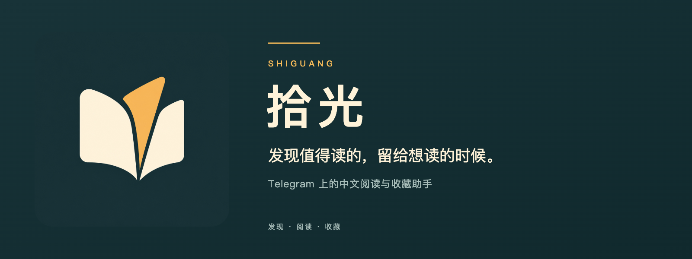

  

<h1 align="center">拾光</h1>

在 Telegram 发现好文章，用中文读懂，把喜欢的留给自己。

  <a href="https://t.me/hacker_news_faster"><strong>去频道看看 ↗</strong></a>
  &nbsp; · &nbsp;
  <a href="https://t.me/hackernews_dailybot?start=saved"><strong>打开拾光 Bot ↗</strong></a>
  &nbsp; · &nbsp;
  <a href="docs/development.md">自己搭一个</a>

---

每天都有值得读的东西，也总有来不及读的时候。

**拾光是一个 Telegram 阅读与收藏助手。** 目前从 Hacker News 开始，把热门文章、社区讨论整理成中文，送到你熟悉的聊天界面。先看看讲了什么，感兴趣就继续读，没时间就先收藏。

## 一篇文章，可以这样读

### 先花一点时间，看看值不值得

频道里先给你一段中文概览：文章在讲什么，有哪些值得关注的观点。旁边附上阅读时间，方便决定现在读，还是留到稍后。

### 想多看一点，就翻进正文和讨论

能获取到原文的文章，会整理成适合长读的中文页面。社区里有价值的补充、质疑和不同意见也会单独呈现，附上评论链接，方便顺着看下去。

### 喜欢的内容，留在自己的清单里

点文章下的「收藏」，回到拾光 Bot 就能找到。喜欢和收藏按钮会显示总人数，你的个人收藏清单在私聊里查看。

## 从第一篇收藏开始

1. **[打开频道](https://t.me/hacker_news_faster)**，挑一篇感兴趣的文章。
2. **点「☆ 收藏」**，把它留到想读的时候。
3. **[打开拾光 Bot](https://t.me/hackernews_dailybot?start=saved)**，点击「开始」，发送「我的收藏」或 `/saved`。

读到想多理解一点的地方，可以在 Bot 中选中文章，点「聊聊这篇」接着提问。问答有次数与间隔限制，具体以 Bot 提示为准；个性化推荐仍在内测。

内容由 AI 整理，可能存在遗漏或误读。原文和 HN 讨论入口会保留，重要信息请回到原始来源确认。

## 也可以拥有自己的拾光

想运营自己的中文阅读频道，或一起改进拾光？这份仓库包含文章整理、频道发布和阅读助手的实现。

[搭建与开发](docs/development.md) · [反馈问题](https://github.com/luoling8192/hn-digest/issues)

本项目采用 [AGPL-3.0-only](LICENSE) 开源许可。
